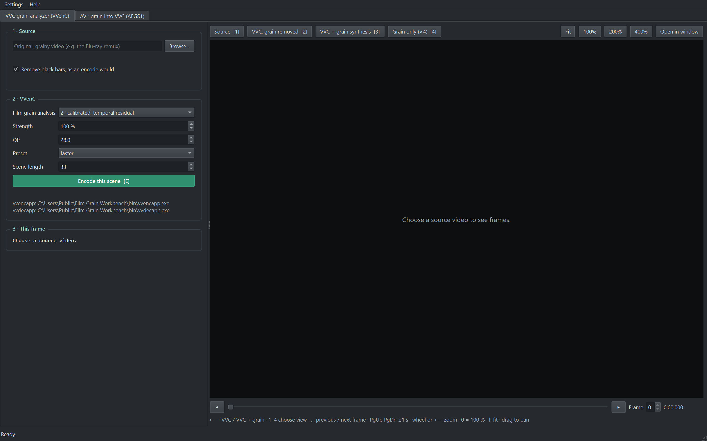
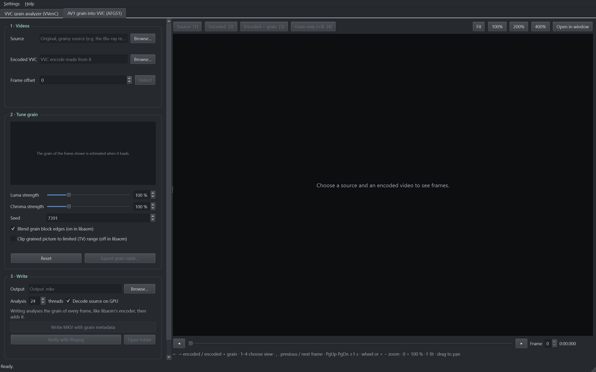

# Film Grain Workbench

See what VVC encoding does to a film's grain, compare VVenC's three film grain
analysis modes side by side, and put the grain an encode lost back into it as
AV1 film grain (AFGS1) metadata that players synthesise at playback.

## Features

**VVC grain analyzer (VVenC + vvdec)**
- Pick any scene of a film and encode it with VVenC in all three film grain
  analysis modes (`--fga 1`, `2`, `3`); the mode chosen shows first, the others
  follow in the background.
- Four views of every frame, switched with one key: the source, VVC with the
  grain removed, VVC with vvdec's grain synthesis, and the grain alone.
- The grain parameters each frame carries, read from the bitstream, with how
  much grain VVenC removed and vvdec adds back, in numbers.
- 4K HDR (PQ, HLG) sources, black bars found and cropped as an encode would.



**AV1 grain into VVC (AFGS1)**
- Measures the grain a VVC encode lost with libaom's own noise model, frame by
  frame, the way libaom's encoder does with `--denoise-noise-level`.
- A live preview: the grain of the frame shown is estimated as it loads, and
  luma and chroma strength are tuned on real frames, rendered with the same
  algorithm decoders use.
- Writes every picture of the encode with its own AFGS1 parameters into a new
  MKV, keeping audio, subtitles, chapters, attachments and HDR properties.
- Verify decodes the written file with ffmpeg and checks it is bit-identical
  to the preview.
- A whole-film analysis resumes where it stopped, and is reused once done.
- Export the tuned grain as an AOM film grain table (aomenc, SVT-AV1
  `--fgs-table`).



**Built to stay responsive**
- Everything slow (decoding, analysis, encoding, writing) runs off the
  window's thread, and the long work at low priority: browsing a 4K film
  stays smooth while VVenC encodes a scene on every core.
- Native C++ and Qt; VVenC, vvdec and the grain analyzer are included.

## Quick start

1. Download `FilmGrainWorkbench-<version>-win64.zip` from
   [Releases](../../releases) and unzip it anywhere. Nothing is installed;
   delete the folder to remove it.
2. Run **Film Grain Workbench.exe**.
3. **VVC tab:** choose a source video, find a scene, press **E**. Switch views
   with ← / → or 1-4.
4. **AV1 tab:** choose the source and its VVC encode, tune the strength, press
   *Write MKV with grain metadata*, then *Verify with ffmpeg*.

## Requirements

Windows 10 or 11, 64-bit. The app needs two free programs it does not
include:

- **ffmpeg and ffprobe** with VVC decoding, FFmpeg 7.1 or newer
  ([ffmpeg.org/download.html](https://ffmpeg.org/download.html), for example
  the gyan.dev "full" build). The AV1 tab's *Verify* also needs an ffmpeg that
  applies AFGS1 grain to VVC (9.0.1 does).
- **mkvmerge** from [MKVToolNix](https://mkvtoolnix.download/), only to write
  MKVs in the AV1 tab.

The app finds them on `PATH`, in MKVToolNix's install folder, or in its own
`bin` folder; otherwise set them under *Settings → External programs*.
*Help → Check installation* lists what was found. To see the written grain,
a player must apply AFGS1 to VVC (ffmpeg-based players such as mpv).

## VVC grain analyzer

Choose a source video and browse it for a scene: only the source is decoded
while you look. Black bars are found and cropped, as an encode would.
*Encode this scene* (E) encodes the frames around the one shown with VVenC in
all three film grain analysis modes:

| Mode | Analysis |
| --- | --- |
| `--fga 1` | VTM's analysis (JVET-AN0237), frequency filtering model |
| `--fga 2` | the same, with the grain measured from the temporal residual and calibrated scaling |
| `--fga 3` | like 2, with the auto-regressive grain model (only some decoders, such as vvdec, synthesise it) |

Each mode writes an H.274 film grain characteristics SEI message; vvdec decodes
every encode twice, without and with its grain synthesis. The selected mode is
shown as soon as it is ready; the other two are encoded in the background, so
switching modes is then instant. VVenC analyses the grain once per GOP (32
frames), switching to new parameters exactly at a scene cut, and writes the
message only where the parameters change and at random access points; it
persists, so the pictures in between keep the latest parameters. Inside the
encoded scene the views are:

1. **Source**: the source frame, cropped like the encode.
2. **VVC, grain removed**: what VVenC coded (its MCTF pre-filter and the
   quantisation remove the grain), decoded with film grain synthesis off.
3. **VVC + grain synthesis**: the same, decoded with vvdec's synthesis on.
4. **Grain only (×4)**: the grain vvdec adds.

The side panel shows the grain parameters the frame carries (read from the
bitstream, both the frequency and the auto-regressive model), how much grain
VVenC removed and vvdec adds, and the colour shift the grain causes. Inside an
encoded scene, changing the strength, QP or preset encodes the scene again;
a new scene length applies when *Encode this scene* is pressed next. HDR
sources (PQ, HLG) are encoded as HDR.

Temporary files: one scene at a time, in a folder in `%TEMP%` (for 33 frames
at 3840×1608 about 4.3 GB). Whatever is replaced is deleted as soon as nothing
reads it, the folder when the app closes, and folders left by a crash when the
app next opens.

## AV1 grain into VVC

1. **Videos.** Choose the source and the VVC encode made from it. *Detect*
   finds the frame offset (up to ±48 frames) if the encode was trimmed; a
   larger one, for an encode cut from far into the film, is typed in. Write
   refuses to start when the frames do not match.
2. **Preview and tune.** The grain of the frame shown is estimated as it
   loads. Luma and chroma strength scale it exactly; the grain is rendered with
   the same algorithm decoders use.
3. **Write.** Every frame is analysed the way libaom's encoder does with
   `--denoise-noise-level`: one model carried through the film, updated on each
   frame and restarted when the noise changes, so the grain follows the film
   shot by shot. This takes a few hours for a 4K film on all CPU threads;
   progress is saved about once a minute, so a stopped run resumes, and a
   finished analysis is reused. Every picture then gets a complete AFGS1
   parameter set with its own seed. Audio, subtitles, chapters, attachments
   and HDR properties are carried over.
4. **Verify.** ffmpeg decodes a frame of the written file; the app checks it is
   bit-identical to the preview.

Grain flags default to libaom's: overlap on, no clipping to the limited range.
To see the grain, the player must apply AFGS1 to VVC (ffmpeg-based players
such as mpv).

## Viewer keys

| Key | Action |
| --- | --- |
| ← / → | Without / with grain |
| 1 2 3 4 | Source, without grain, with grain, grain only (×4) |
| , / . | Previous / next frame |
| PgUp / PgDn | ±1 second |
| E | Encode this scene (VVC tab) |
| wheel, + / − | Zoom (nearest-neighbour from 100 %, so single grains stay sharp) |
| 0 / F | 100 % / fit |
| drag | Pan |

*Open in window* shows the frame alone in a resizable window with the same keys.

## Troubleshooting

- *Help → Check installation* shows every program the app uses, where it was
  found and its version; *Copy* puts the report on the clipboard for a bug
  report. The same report can be written from the command line:
  `"Film Grain Workbench.exe" --check-installation report.txt`.
- Unexpected errors are written to
  `%APPDATA%\AFGS1Workbench\AFGS1 Grain Workbench\errors.log`.

## Build from source

The app is C++20 with Qt 6 Widgets. It needs Visual Studio 2022 (the C++
workload), CMake 3.25 or newer, Qt 6.5 or newer for MSVC 2022 64-bit and
Python 3.11 or newer (only its standard library, for the build scripts).

```bat
py -3 build.py --qt C:\Qt\6.12.0\msvc2022_64
```

`build.py` builds the programs in `bin`, then the app and the download in
`build\FilmGrainWorkbench-<version>-win64.zip`. One part at a time:
`--only analyzer`, `--only vvc` or `--only package`; `--qt` is needed only the
first time.

- The grain analyzer (`analyzer/build.py`) needs gcc, cmake, ninja and git; it
  fetches libaom and builds it with gcc, like libaom's own Release build, so its
  floating-point results match libaom's.
- vvencapp and vvdecapp (`vvc/build_vvc_tools.ps1`) need Visual Studio 2022,
  CMake and git. VVenC is fraunhoferhhi/vvenc pull request 765, which includes
  pull request 764; vvdec is its master branch with pull request 450 (film
  grain for 4:2:2, 4:4:4 and 4:0:0).
- The app (`packaging/package.py`) builds with CMake; Qt's DLLs come from
  windeployqt, FFmpeg's LGPL libraries from `native/ffmpeg`.

To work on the app:

```bat
cmake --preset windows -DCMAKE_PREFIX_PATH=C:\Qt\6.12.0\msvc2022_64
cmake --build --preset windows-release
ctest --preset windows-release
```

The app is then `build\cmake\src\app\Release\Film Grain Workbench.exe`.
Sources: `src/core` (the engine, no Qt), `src/platform` (running programs),
`src/app` (the window). `fgw_walkthrough` (`tests/tools`) drives the window on
real files, offscreen, and reports how long each step took and the longest
the window did not respond.

## Notes on compatibility

- **Why not ffmpeg for muxing:** ffmpeg does not rebuild decode timestamps for
  VVC read from Matroska, so `ffmpeg -c copy` collapses the timestamps of any
  VVC MKV. The video track is written by the app and merged with mkvmerge.
- **ffmpeg's AFGS1 parser** reads chroma point fields that the specification
  omits when a chroma curve is empty, so "no chroma grain" is written as a
  single zero-strength point, which every parser reads the same way.
- **ffmpeg 9.0.1** fails ("File exists") when it applies grain to a stream
  whose MKV track header carries HDR mastering / light-level metadata. When the
  VVC stream already carries that metadata in SEI (VVenC encodes do), it is not
  repeated in the track header.
- VVC's own H.274 film grain SEI is not used in the AV1 tab: ffmpeg only
  applies it to 8-bit video.

## License

MIT (`LICENSE`). The download also contains third-party programs and libraries
under their own licenses; see `THIRD_PARTY_NOTICES.md`.
